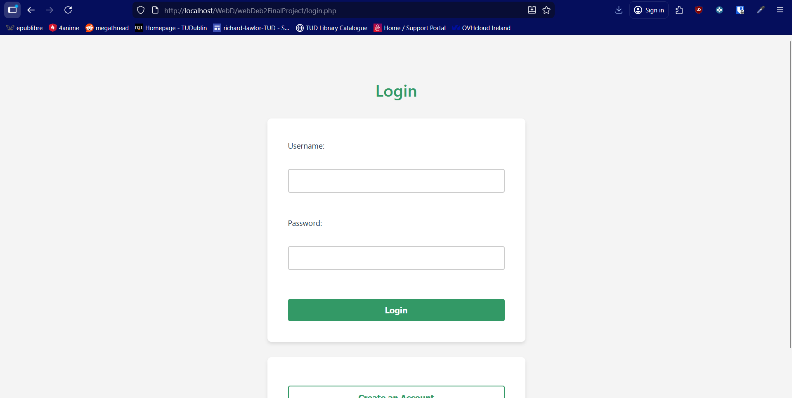
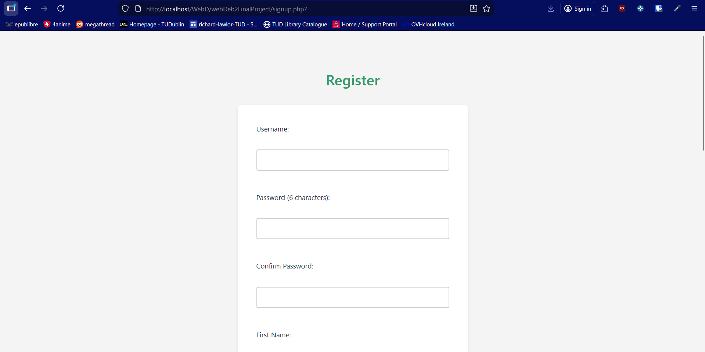
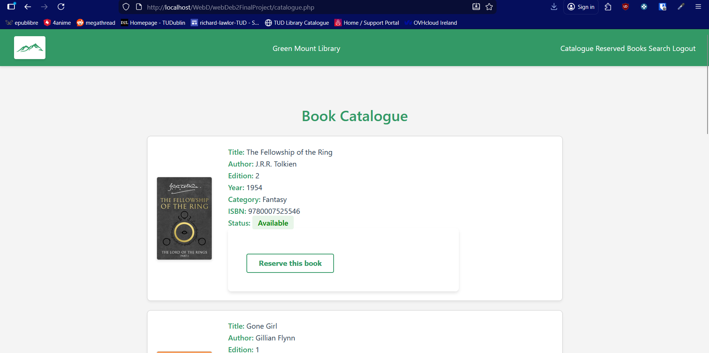
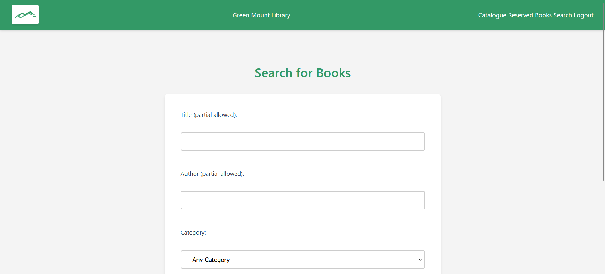
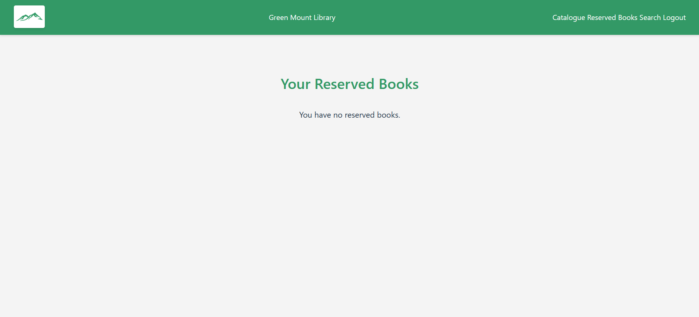

# GreenMountLibrary

A multi-user library reservation system built for my Web Development 2 module. Users can sign up, log in, browse the book catalogue, reserve titles, and manage their reservations from a personal dashboard.

Highlights

Server-side validation over a relational MySQL schema prevents reservations on titles that are already out on loan
PHP session authentication keeps each user’s reservations scoped to their own account

Tech: PHP, MySQL, JavaScript, XAMPP

Running locally: install XAMPP, start Apache and MySQL, import the SQL file into phpMyAdmin, and place the project folder in htdocs.

### Log In

### Sign Up

### Catalogue

### Search For Books

### Reserved Books

